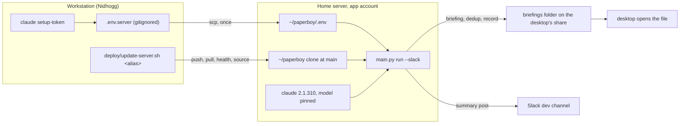

# Session: COURIER Wave 2 Host Proof, the Server's Model, and the First Deploy

**Date**: 2026-10-25
**Branch**: main
**Tags**: #session #infra #config #setup #docs #bugfix #in-progress #pillar-2 #pillar-4

**Documents**: [deploy/README.md](../../deploy/README.md) — steps 4 to 6 rewritten from what worked, four traps dated today | [docs/tasks.md](../tasks.md) — Focus steps 3 and 4 narrowed, two P3 tasks filed, two closed | [docs/gaps.md](../gaps.md) — G5 and G8 amended with today's readings | [CHANGELOG.md](../../CHANGELOG.md) — the Wave 2 block under Unreleased | [config/project.yaml](../../config/project.yaml) — `paperboy` in the roster
**Implements**: [conop_COURIER_daily_run_slack_delivery.md](../plans/conop_COURIER_daily_run_slack_delivery.md) — Wave 2 task 2.2 and the host proof (A0, A1, A3, A4); the status log entry of 2026-10-25
**References**: [20261024_courier_wave2_server_setup.md](20261024_courier_wave2_server_setup.md) Next Steps — the morning's commands, followed in order | [HOME-STORAGE.md](../../.claude/skills/lake-conventions/HOME-STORAGE.md) — the boundary line this record keeps
**Follows**: [20261024_courier_wave2_server_setup.md](20261024_courier_wave2_server_setup.md)

---

## Summary

The home server now runs the pipeline end to end as the `paperboy` account, on the subscription, writing to the desktop's share and posting to the dev channel. The lead did the browser and web-shell steps; Claude did the rest over the SSH alias after the lead said editing over ssh was too hard. Along the way three things in the runbook turned out wrong or missing and were fixed from measurement: a non-login shell has no `claude` on PATH, which would have failed the deploy script's own proof; the deploy script had no executable bit; and the server's CLI, with no model configured, distilled on a different model than the workstation. The lead chose `claude-opus-5-5` for the daily run. Two commits landed on main and the deploy brought the server's clone to head. The App and the canary remain.

| Metric | Value |
|---|---|
| Host proof `run --slack` on the server | exit 0, 131 s, 5,248 words, post accepted |
| Deploy (`deploy/update-server.sh`) | clone aaaeb07 to 0ea43f1; health and source passed; G5 post-rewrite |
| Commits on main | 2 (`46bdf4b`, `0ea43f1`), both pushed, plus the one carrying this doc |
| Tests at start / at close | 356 / 360 (four new, each red first) |
| Runbook instructions proved wrong in practice and rewritten | 2 (edit over ssh; ACL diagnosis as the account) |
| Traps met today, now in `deploy/README.md` | 4 |
| Hook-driven reviews | 2 (`/pci` after the `.gitignore` line: 0 findings; a suite run: green) |
| Knowledge-base traversals | 1 |

## Work Completed

### 1. Where the morning started

`/session-start` measured a clean main at `1c5308b`, 356 tests, Nidhogg in the roster, no doctrine update, and the G5 probe exit 0 on this box. The evening record's one UNVERIFIED claim, the server's three runtime lines, was the first thing re-run over the alias: `2.1.310 (Claude Code)`, imports `ok`, `crontab is valid`; the clone clean at `aaaeb07`; no `.env` yet.

KB-graph: the `Follows` and `Documents` edges of the 2026-10-24 evening record → `deploy/README.md` steps 5 and 6, followed as written → two of its instructions failed in practice (the `nano` edit over ssh the lead could not complete; the ACL probe run as the account, which cannot read a dataset's ACL type) → both rewritten in section 8 below (M2: 2 caught, 2 fixed).

### 2. The PATH question

The lead pasted `claude --version` printing nothing in a shell where yesterday's install had printed the version, and asked whether the account lacked permission. Measured over the alias: the binary is owned by the account at mode 755 and runs by full path; `bash -lc 'type claude'` finds it; `bash -ic` does not. Debian's `.profile` adds `~/.local/bin` only at login and only if the folder exists then, so a session opened before the install, `su paperboy`, and `ssh <alias> 'command'` all lack it. The same measurement, run through the venv's Python, showed `shutil.which("claude")` returning None in a non-login shell. That is the shell `deploy/update-server.sh` uses for its proof, so `AgentRunner.is_available` would return False, `health` would print `claude_cli FAILED` and exit 1, and the deploy would die at its proof. Fixed test-first in section 8. The container is unaffected: the App YAML sets PATH.

### 3. The server's `.env`, staged on the workstation

The lead asked for a simpler way than editing over ssh. `.env.server` was built at the repo root as a copy of the workstation's `.env` plus two blank lines, mode 600, and `.env.server` added to `.gitignore` (verified with `git check-ignore`). The lead filled the two values in the IDE. Three checks ran before anything moved, none printing a value: the folder line had the key typed twice (`HOME_BRIEFINGS_ROOT=HOME_BRIEFINGS_ROOT=...`), fixed by `sed`; the file sourced cleanly in bash the way the runbook loads it; the token's shape was checked by prefix and length only.

### 4. The token

The first paste was 92 characters with no `sk-ant-oat01-` head. Tested on Nidhogg with the value in the environment, which outranks the stored login: as pasted, `401 Invalid bearer token`; with the head restored, `Not logged in`. The lead minted it again and copied the whole line: 108 characters, the right prefix, and `OK` from `claude -p` on this box. Then one `scp` to `~/paperboy/.env`, `chmod 600`, five key names confirmed on the server, and `OK` again as the account in a login shell. Inside the clone the CLI first printed a trust warning about the repo's `.claude/settings.json`; from `~` it did not. The pipeline runs the CLI from the system temp directory and never sees it.

### 5. The share and its ACL

The lead asked whether `HOME_BRIEFINGS_ROOT=output/briefings/daily` would do. It would resolve inside the clone on the apps dataset, where the desktop cannot reach it and a re-clone would erase the record, so the answer was an absolute mount path on a dataset the desktop mounts. The pool's datasets were listed as the account; the lead named the one the desktop sees (`media` is pictures). The account could not enter it. Two entries were given for the web shell: traverse on the dataset, full rights with inheritance on the account's own folder, in the `nfs4xdr_setfacl` form that worked on the apps dataset yesterday.

Here the session's one wrong call: when the account still could not enter the dataset, `getfacl` showed a plain `user::rwx group::rwx other::---` and `nfs4xdr_getfacl` failed, and Claude concluded the dataset was POSIX and gave `setfacl` lines instead. The lead then reported a missed `sudo` password prompt and re-ran; the account could enter and write. The full `nfs4xdr_getfacl`, now readable, showed the NFSv4 entries from the first lines in place, plus `builtin_users` inheriting read and write, so the desktop will open what the account writes. The `getfacl` output had been the trivial view of the mode bits, and the earlier `nfs4xdr_getfacl` failure the account's own lack of the read-ACL right. The account created `briefings` itself (inheriting the entry) and the touch-and-remove probe passed.

### 6. The host proof

As the account in a login shell with `.env` loaded: `claude -p` OK (section 4); `main.py health` with arxiv, blogs, claude_cli and slack OK, claude_api SKIPPED, exit 0; then `main.py run --slack` in the background, 131 seconds, exit 0. On the share: the 5,248-word briefing, `.selection_history.json`, and `run_history.jsonl` with the server's first line (`status: success`, `slack_ts` set, `slack_error` null, `backend: agent`, `git_sha: aaaeb07`). The paper is the one the workstation chose yesterday, as an empty dedup history on the share predicts. The record's `machine` field carries the host's own name, which the roster omits by the boundary line; the container will report `paperboy`. The clone stayed clean: nothing is written under it.

### 7. The model

The record line read `distill_model: claude-sonnet-5-5`, where yesterday's gate run on Nidhogg had `claude-fable-5-1`. Measured: this box pins `claude-fable-5-1` in its own `~/.claude/settings.json`; the server's had no `model` key, so the CLI used its own default. The lead chose `claude-opus-5-5` for the daily run ("definitely not sonnet"). Written into the server's `~/.claude/settings.json` beside the updater flag, and proven by a `claude -p --output-format json` call whose `modelUsage` named only `claude-opus-5-5`. The CLI settings file is an input the config hash does not see; a P3 task proposes `claude.agent_model` passed as `--model`.

### 8. Step 8: the commits and the deploy

Two commits on main, lead-only work by the branching doctrine:

- `46bdf4b`: the `paperboy` roster entry (role server, backend agent); the deploy script's proof string exports PATH, driven by `tests/test_update_server_script.py`, whose assertion failed on exactly the missing `.local/bin` and passed after the one-line change; `.env.server` in `.gitignore`; `deploy/README.md` step 4 with the `model` key, step 5 rewritten around the staging file with the local token test before the copy, step 6 with the second dataset's two entries and the diagnose-as-admin rule, the login-shell note for the host proof, and four traps dated today; the CONOP status log entry.
- `0ea43f1`: the first dry run died with `Permission denied`: the script was mode 100644 in the index since its creation, the audit hook's defect of 2026-10-22 in a new file. Two tests written first (on-disk and index mode, the hook test's pattern), red, then `chmod +x` and `git update-index --chmod=+x`, green.

Then `deploy/update-server.sh <alias> --dry-run` showed the three-commit plan with no reinstall, restart or env comparison, and the deploy ran: clone at `0ea43f1`, health and source passed through the PATH-fixed proof, CLI `2.1.310`, the renewal comment read back (`generated 2026-10-25; renew by 2027-10-25`), `G5: clone is post-rewrite`.

### 9. Found on the way

- `ssh <alias> 'command'` is a non-login shell everywhere this repo scripts the server. The deploy script now sets PATH; the runbook says "login shell" where a human runs the proof.
- The CLI's default model differs by box unless pinned; the record caught it, which is what Pillar 4's audit is for. Task filed.
- The boundary test cannot name the server's hostname, pool or alias without tracking them. Task filed for a gitignored word list it reads when present.
- The `/pci` hook fired after the `.gitignore` line and found nothing; a suite-run hook fired once and found nothing owed.

KB-graph: `/pcc` check 5 at session end, after the Focus, register and CHANGELOG edits and with this doc's path named in Focus step 4 → 34 paths, 0 MISSING; the doc's own eight header links resolve (M2: 0 caught).

### What runs where, after today

## Claims

| Claim | State | Evidence |
|---|---|---|
| The server's clone is at main's head and clean | deployed | `ssh <alias> 'git -C ~/paperboy log --oneline -1; git -C ~/paperboy status --porcelain --untracked-files=no'` → `0ea43f1 [fix][test] deploy/update-server.sh: executable bit...`, no status lines (re-run at session end) |
| main is pushed at `0ea43f1` before this doc's commit | deployed | `git rev-list --count origin/main..main` → `0`; `git rev-parse --short origin/main` → `0ea43f1` (at session end, before the doc commit) |
| The suite passes | tested | `.venv/bin/pytest -q` → `360 passed`, run after the last code change and again after the register edit (`tests/test_gaps.py` → `32 passed`) |
| The server CLI answers on `claude-opus-5-5` | observed | `claude -p "Reply with OK" --output-format json` as the account → `result: OK`, `models used: ['claude-opus-5-5']`; `~/.claude/settings.json` re-read at session end → `"model": "claude-opus-5-5"` |
| The host proof run succeeded and the post was accepted | observed | the run log → `run_exit=0`, 14:01:39 to 14:03:51; `run_history.jsonl` on the share re-read at session end → `status: success`, `slack_ts: 1792955031.373919`, `slack_error: None`, `backend: agent`, `duration_s: 130.875`, `git_sha: aaaeb07` |
| The share holds the briefing, the dedup file and the record | observed | `ls -la <briefings-folder>` at session end → `.selection_history.json` (190 B), the `261025_..._briefing.md` (31,849 B), `run_history.jsonl` (1,591 B) |
| `health` exits 0 on the server | observed | as the account, login shell, 13:57 → `arxiv OK, blogs OK, claude_api SKIPPED, claude_cli OK, slack OK`, `health_exit=0`; and the deploy's own proof at `0ea43f1` → `health and source passed` |
| The account can write the briefings folder and the desktop's group can read it | observed | `mkdir -p ... && touch .../.probe && rm .../.probe` → `probe: ok`; `nfs4xdr_getfacl <folder>` → `user:paperboy:rwxpDdaARWc--s:fd----I:allow`, `group:builtin_users:rwxpDdaARWc--s:fd----I:allow` |
| Gap G5 for the server's clone: post-rewrite | observed | `deploy/update-server.sh <alias>` → `G5: clone is post-rewrite` |
| The deploy script's proof sets PATH and the file is executable in the index | tested | `.venv/bin/pytest -q tests/test_update_server_script.py` → `4 passed`; `git ls-files -s deploy/update-server.sh` → `100755 ...` |
| No tracked file carries the server's hostname, pool, alias or uid | measured | `git grep -n -i -E "<hostname>\|<pool>\|<alias>\|<uid>" -- . ':!docs/sessions'` over the tree at session end → none (the pattern itself is not written here) |
| The dev-channel post renders with every section and the desktop opens the file | UNVERIFIED: the lead has not yet reported opening the file or reading the post; `slack_ts` proves acceptance, not rendering | |
| The container resolves the roster key `paperboy` | UNVERIFIED: the App does not exist yet; the first tick's record line (`machine: paperboy`) is the check | |

Overclaims the user caught this session: 1

Overclaims a reviewer caught this session: 0

The user's: the claim that the share's dataset was POSIX-ACL, made from `getfacl` output read as the account and acted on by the lead at the web shell, which Claude's own later probe refuted (section 5). No reviewer agents ran this session.

## Key Decisions

| Decision | Rationale |
|---|---|
| `claude-opus-5-5` for the daily run on the server | The lead's choice between the workstation's `claude-fable-5-1` and the CLI's default `claude-sonnet-5-5`; pinned in the server's CLI settings, not in code, so no release is needed; the record shows the model that ran |
| Stage the server's `.env` on the workstation as gitignored `.env.server`, send it by one `scp` | The lead found editing over ssh hard and asked for help; the file can be checked here first without printing a value |
| The briefings folder on the desktop's share, not under the clone | The desktop must open the file by the name in the post; a re-clone must not erase the record; the home-storage convention wants the server's own absolute mount path |
| Traverse only on the dataset, full inherited rights on the account's folder | Least privilege; `builtin_users` already inherits read for the desktop |
| Roster entry, script fix and deploy before the App | The deploy's proof covers health and source on the clone the App will run; the clone is at head before the first tick |
| The server's hostname, pool, dataset paths, alias and uid stay out of this record and every tracked file | The boundary line; they live on the machines and in the lead's local memory |
| Claude does the ssh-side work; the lead keeps the web shell, the browser and local edits | The lead's request; recorded as a standing preference |

## Pillar Compliance

| Pillar | Status | Notes |
|---|---|---|
| **Content Quality First** | NOTE | No prompt change. The distilling model on the server is now a deliberate choice, where the first server run had taken the CLI's default |
| **Source Diversity & Resilience** | PASS | `health` and `source` pass on the server in both shell modes the repo uses; no code path changed |
| **Pipeline Idempotency** | PASS WITH A TASK | The record caught a per-box model difference the config hash cannot see: the CLI settings file is an input. Task filed to move the model into config |
| **Extensibility by Design** | UNCHANGED | No interface touched |

## Commits

| Hash | Subject |
|---|---|
| `46bdf4b` | [config][infra][doc][test] COURIER Wave 2: paperboy roster entry; deploy proof sets PATH for non-login shells; .env.server staging; the day's traps |
| `0ea43f1` | [fix][test] deploy/update-server.sh: executable bit in the index, asserted by two tests written first |

The commit that carries this doc, the task list, the gap register and the CHANGELOG block is reported in the session's final message.

## Next Steps

- [ ] **The lead**: open the host-proof briefing from the desktop by the filename in the dev-channel post; read the post for title, link, reasoning, top five, filename, legend and telemetry line.
- [ ] **The lead**: the App in the TrueNAS UI (Apps, Discover Apps, Custom App, Install via YAML, name `paperboy`) from `deploy/README.md`'s YAML with the uid, the home and the briefings folder filled in and a second volume line for the folder, `TZ: America/Chicago`; saved away from 05:30.
- [ ] The first tick at 05:30 the next morning: a post by 05:45, a new record line with `machine: paperboy` and `distill_model: claude-opus-5-5`, a different paper from today's.
- [ ] The canary: the runbook's six-line checklist for seven mornings; then the real channel id in the server's `.env`.
- [ ] Focus step 3 (Phase 2's close by command, v0.3.0, the public flip) either side of the canary; Muninn's G5 reading at its next `/session-start`.
- [ ] The two P3 tasks filed today: `claude.agent_model` passed as `--model` and hashed; the gitignored `.boundary-words` list for the boundary test.
- [ ] Hub harvest into `.claude/upstream-lesson.md`: a non-login shell's PATH as a deploy trap; the executable bit as a test on every script a runbook invokes; stage a server's env file on the workstation; diagnose an ACL type as admin.
